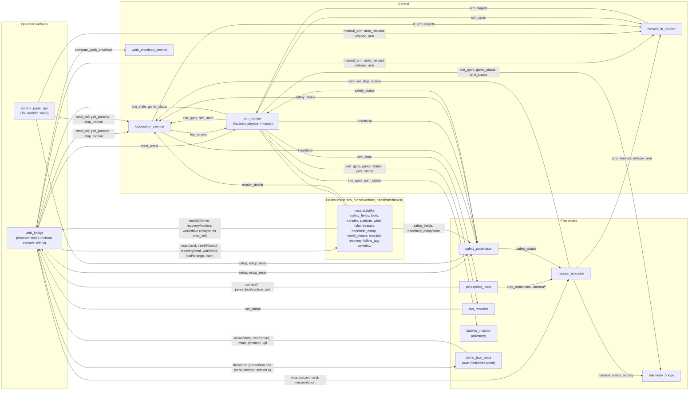
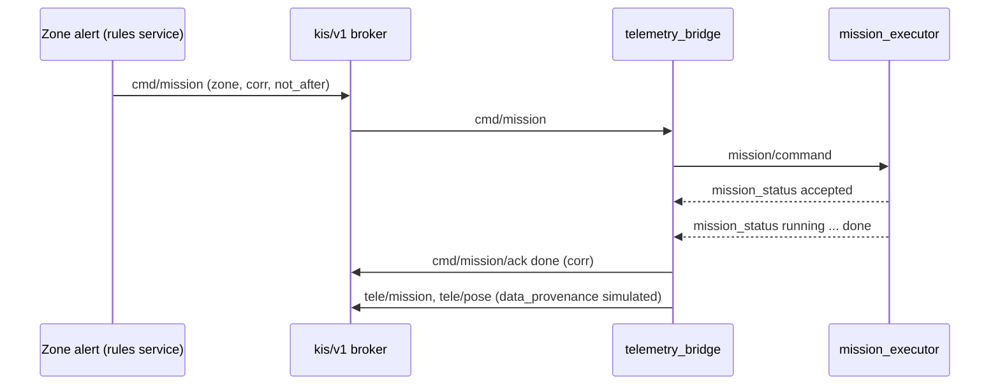

# High-level design (HLD)

Status: draft. Gaps covered: SW-14 (node graph and contract), DOC-01. WP12 (2026-11-18) folds the per-package orchard MVP contract notes into this document (section 7) and re-checks every status against `feat/nandi-pilot` @ 1840118.

Scope: the Atharv Nandi software on `feat/nandi-pilot`. The ROS contract is the top-level [README](../README.md), section "ROS 2 Interface", plus the orchard package contracts indexed in section 7; this document must agree with the README. Code wins where they disagree.

Status labels: `atharv_nandi/` [BUILT] means the name is a string in the Python code under `atharv_nandi/` (checked on every test run by `tests/test_design_docs.py` and `tests/test_wp12_docs.py`); [PROPOSED] means it is not in code. The five pilot nodes that were [PROPOSED] in the first draft of this document (safety, mission, perception, telemetry, recorder; read from their worktrees on 2026-11-17) have all merged and are [BUILT] now. Section 6 lists which of their naming conflicts are left.

## 1 Node graph



Reading guide: start at the operator surfaces on the left. Commands flow into the four control nodes, which close the loop through `sim_runner` and `/nandi/sim_qpos`. The orchard packages (WP1-WP7, WP13, WP24-WP29, WP34) do not add ROS nodes: each adds a hook file in `atharv_nandi/sim/hooks/` that `sim_runner` (live) or `SimDriver` (tests, the tour) runs at its rate or before every physics step, with topics in and out through the hook bus. `safety_supervisor` can freeze the loop: `sim_runner` safe-holds every actuator while the latch is set, and the supervisor adopts the WP6 field latch and the WP1 handheld e-stop as latches. `demo_tour_node` (WP9) runs the orchard tour in its own headless `SimDriver` world, not in the live `sim_runner` world (WP11 F-3). `stability_monitor` only listens. Arrows are labelled with topic or service names without the `/nandi/` prefix; the graph shows the main flows only, section 7 has every topic.

## 2 Nodes

| Node | File | Status | Role |
|---|---|---|---|
| sim_runner | `atharv_nandi/nodes/sim_runner.py` | [BUILT] | Steps MuJoCo, hosts the viewer, runs the hook registry (WP0), publishes `sim_qpos` (every 0.02 s of sim time), `sim_state` (every 1/30 s), `joint_states`, `heartbeat` and `game_status` (every 0.5 s wall), safe-holds while the supervisor latches or is silent for 1.0 s (`supervisor_lost`), serves `reset_world`; declares the parameters `world_id`, `layout`, `hooks` (WP0) |
| locomotion_service | `atharv_nandi/nodes/locomotion_service.py` | [BUILT] | `cmd_vel` + `gait_params` to leg targets (tripod or RL); dead-man 0.5 s (`HOLD_TIMEOUT_S`); speed cap, stale-`sim_qpos` hold, refuses `cmd_vel` while e-stopped; honours `/nandi/motion_inhibit` (WP6 `MotionInhibitGate`: stance / walk / stop, `speed_scale`) |
| harvest_ik_service | `atharv_nandi/nodes/harvest_ik_service.py` | [BUILT] | Arm arbitration (`rl_balance` / `ik_harvest` / `manual`) and the legacy pick-and-place sequence ([state-machines.md](state-machines.md) sections 3 and 4) |
| work_envelope_service | `atharv_nandi/nodes/work_envelope_service.py` | [BUILT] | Reachability wireframe on demand |
| web_bridge | `atharv_nandi/nodes/web_bridge.py` | [BUILT] | Browser console on :8080 (WP10 orchard console: map, tree card, preset bar, queue, crown gauge, recovery, jobs), `/healthz`, `/media/`, operator auth and audit; relays the hooks' drive topics onto `cmd_vel` |
| control_panel_gui | `atharv_nandi/nodes/control_panel_gui.py` | [BUILT] | Tk console in the noVNC desktop |
| safety_supervisor | `atharv_nandi/nodes/safety_supervisor.py` | [BUILT] | Latched software e-stop (`operator`, `geofence`, `fall`, `handheld`, and the WP6 field reasons `protective`, `animal`, `bumper`, `stability`), node liveness from heartbeats. Software only: the field requirement is a hardware e-stop that removes motor power, and software never overrides it |
| mission_executor | `atharv_nandi/nodes/mission_executor.py` (logic in `atharv_nandi/core/mission_logic.py`) | [BUILT] | Legacy zone mission (walk, harvest, return; [state-machines.md](state-machines.md) section 2); publishes `/nandi/mission_status` (and `/nandi/mission/status` for the console) and `/nandi/battery` / `/nandi/battery_status` |
| perception_node | `atharv_nandi/nodes/perception_node.py` | [BUILT] | Simulated cameras (head, wrist, crown, ring 0-3, pano), privacy filter (`FilteredFrame`), TREE 360 render mode and captures, truth-plus-noise detector (WP5). The LiDAR topics come from the `lidar` hook inside `sim_runner`, not from this node |
| telemetry_bridge | `atharv_nandi/nodes/telemetry_bridge.py` | [BUILT] | Maps status topics to `kis/v1` payloads (section 4), writes `runs/<run_id>/kis_v1.jsonl`; MQTT sink off by default |
| run_recorder | `atharv_nandi/nodes/run_recorder.py` | [BUILT] | Writes `runs/<run_id>/` (meta, attempts, events, manifest) and publishes `run_status` |
| stability_monitor | `atharv_nandi/nodes/stability_monitor.py` (logic in `atharv_nandi/core/stability.py`, `load_model.py`, `stability_probe.py`) | [BUILT] | Advisory static-stability and load status `/nandi/stability` (section 3.4); never steps the physics. The enforcing crown and field gates are WP6's hooks (section 7) |
| demo_tour_node | `atharv_nandi/nodes/demo_tour_node.py` (logic in `atharv_nandi/core/demo_tour.py`) | [BUILT] WP9 | `/nandi/demo/run` → the orchard tour in its own headless world → records, job sheets, KPIs. Not started by `launch/launch_nandi.sh` |

## 3 Topic and service table (base stack)

This section covers the base stack (control nodes and pilot nodes). Every topic an orchard package added is in section 7, one row per name, with a link to the fragment that owns its payload. Payloads marked JSON are `std_msgs/String`.

### 3.1 Topics

| Topic | Type | Publisher -> subscribers | Contract source |
|---|---|---|---|
| `/nandi/cmd_vel` | `geometry_msgs/Twist` | UIs, mission_executor, web_bridge relay -> locomotion | `atharv_nandi/` [BUILT] |
| `/nandi/gait_params` | `Float64MultiArray` (4) | UIs -> locomotion | `atharv_nandi/` [BUILT] |
| `/nandi/locomotion_status` | JSON, 2 Hz | locomotion -> UIs, telemetry_bridge | `atharv_nandi/` [BUILT] |
| `/nandi/leg_targets` | `Float64MultiArray` (18) | locomotion -> sim_runner | `atharv_nandi/` [BUILT] |
| `/nandi/rl_arm_targets` | `Float64MultiArray` (5) | locomotion -> harvest | `atharv_nandi/` [BUILT] |
| `/nandi/manual_arm` | `Float64MultiArray` (7) | UIs -> harvest | `atharv_nandi/` [BUILT] |
| `/nandi/arm_targets` | `Float64MultiArray` (7) | harvest -> sim_runner | `atharv_nandi/` [BUILT] |
| `/nandi/harvest_status` | JSON, 2 Hz + on change | harvest -> UIs, mission, safety (liveness), telemetry, recorder | `atharv_nandi/` [BUILT]; WP8 adds `mode: tool_change` |
| `/nandi/sim_qpos` | `Float64MultiArray` (nq) | sim_runner -> all | `atharv_nandi/` [BUILT]; sim-only, retired by the HAL ([hal-sim-to-real.md](hal-sim-to-real.md)) |
| `/nandi/sim_state` | JSON `nandi.sim_state/1`, every 1/30 s sim time | sim_runner -> perception, web_bridge, renderers | `atharv_nandi/` [BUILT] (WP0) |
| `/nandi/game_status` | JSON, 2 Hz | sim_runner -> UIs, mission, telemetry, recorder | `atharv_nandi/` [BUILT] |
| `/nandi/workspace_wireframe` | JSON | UIs, sim_runner -> sim_runner, UIs | `atharv_nandi/` [BUILT] |
| `/nandi/safety_status` | JSON, 10 Hz + on change `{estopped, latched_reason, speed_cap, geofence_ok, fallen, stale, last_stop, nodes, hold_mode, geofence_margin_m, tilt_deg, engaged_at, rearmed_at}` | safety_supervisor -> sim_runner, locomotion, mission, UIs, telemetry | `atharv_nandi/` [BUILT] |
| `/nandi/heartbeat` | JSON `{node, t, ok, info}`, 2 Hz | sim_runner, locomotion, safety_supervisor -> safety_supervisor | `atharv_nandi/` [BUILT] |
| `/nandi/joint_states` | `sensor_msgs/JointState`, every `sim_qpos` publish | sim_runner -> telemetry, recorder, mission (energy model), stability_monitor | `atharv_nandi/` [BUILT] (WP0) |
| `/nandi/mission/command` | JSON `{mission_id, mode: harvest_zone or patrol, zone, not_after, max_picks}` | UIs -> mission_executor | `atharv_nandi/` [BUILT] |
| `/nandi/mission_status` | JSON, 2 Hz | mission_executor -> UIs, telemetry | `atharv_nandi/` [BUILT] |
| `/nandi/mission/status` | the same payload, for the console | mission_executor -> web_bridge | `atharv_nandi/` [BUILT] (section 6) |
| `/nandi/crop_detections` | JSON, <= 5 Hz, carries `model.sha256` of the detector config | perception_node -> mission, telemetry, UIs | `atharv_nandi/` [BUILT] |
| `/nandi/camera/head/compressed` | `sensor_msgs/CompressedImage` JPEG | perception_node -> UIs | `atharv_nandi/` [BUILT] (WP5 row in section 7) |
| `/nandi/run_status` | JSON, 1 Hz, run id and live KPI counters | run_recorder -> UIs | `atharv_nandi/` [BUILT] |
| `/nandi/battery` | JSON, 2 Hz (telemetry also accepts `sensor_msgs/BatteryState`) | mission_executor -> telemetry | `atharv_nandi/` [BUILT] |
| `/nandi/battery_status` | JSON, 2 Hz | mission_executor -> console | `atharv_nandi/` [BUILT] (WP7 row in section 7) |
| `/nandi/telemetry` | JSON | (no publisher) -> console | `atharv_nandi/` [BUILT] as a console subscription only (section 6) |
| `/nandi/stability` | JSON, 10 Hz, advisory (schema in section 3.4) | stability_monitor -> no subscriber yet | `atharv_nandi/` [BUILT] |

### 3.2 Services (`std_srvs/Trigger`)

| Service | Server | Clients | Contract source |
|---|---|---|---|
| `/nandi/toggle_locomotion_mode` | locomotion | web_bridge, Tk console | `atharv_nandi/` [BUILT] |
| `/nandi/stop_motion` | locomotion | web_bridge, Tk console, mission_executor (on exit) | `atharv_nandi/` [BUILT] |
| `/nandi/auto_harvest` | harvest | web_bridge, Tk console, mission_executor | `atharv_nandi/` [BUILT] |
| `/nandi/release_arm` | harvest | web_bridge, Tk console, mission_executor (on exit, e-stop included) | `atharv_nandi/` [BUILT] |
| `/nandi/reset_world` | sim_runner | web_bridge, Tk console | `atharv_nandi/` [BUILT] |
| `/compute_work_envelope` | work envelope | web_bridge, Tk console | `atharv_nandi/` [BUILT] (the one name outside `/nandi/`) |
| `/nandi/estop` | safety_supervisor: latch with reason `operator` | web_bridge, Tk console | `atharv_nandi/` [BUILT] |
| `/nandi/estop_reset` | safety_supervisor: re-arm, refused while the latching cause is still present (`geofence`, `fall`, a pressed handheld, an occupied protective field) | web_bridge, Tk console | `atharv_nandi/` [BUILT] |
| `/nandi/mission/abort` | mission_executor | web_bridge | `atharv_nandi/` [BUILT] |

### 3.3 Tools, configuration and files

| Name | Status | Use |
|---|---|---|
| `tools/headless_eval.py` | [BUILT] | ROS-free, in-process harvest evaluation: `--seeds N --seed0 7 --terrain flat,ridges,rough --max-sim-s S`; writes `runs/<run_id>/` |
| `tools/nandi_kpi.py` | [BUILT] | `python3 tools/nandi_kpi.py runs/<run_id>`: prints the KPI table and writes `kpi.json` |
| `tools/mission_sim_check.py` | [BUILT] | closed-loop mission check in bare MuJoCo |
| `tools/crown_gate_matrix.py` | [BUILT] WP6 | writes `config/crown_gates.json` (`matrix`, `sitdown`, `tipwind`) |
| `tools/spot_tour_bench.py` | [BUILT] WP11 | tour RTF, world budget and capture benchmark with run ids ([test-plan.md](test-plan.md) section 6) |
| `tools/self_right_spike.py`, `tools/feasibility_sweep.py`, `tools/probes/` | [BUILT] | WP28 self-right spike, WP0c feasibility sweep, the spec probes |
| `config/safety.yaml`, `config/telemetry.yaml`, `config/perception.yaml`, `config/perception_orchard.yaml`, `config/crown_gates.json`, `config/missions/`, `config/presets/`, `config/fields/`, `config/crops/`, `config/season/`, `config/trees/`, `config/workflows/` | [BUILT] | thresholds, identities, registries and layouts quoted in this design set. WP6 L0 limits are code constants; `config/safety.yaml` only lists them for reference |
| `runs/<run_id>/` | [BUILT] | `meta.json`, `harvest_attempts.jsonl`, `events.jsonl`, `kis_v1.jsonl`, `joint_effort_summary.json`, `kpi.json`, `manifest.json`, TREE 360 media; kept out of git |
| `tools/mac_gpu/README.md` | [BUILT] | Mac GPU notes referenced by [hal-sim-to-real.md](hal-sim-to-real.md) section 5 |

### 3.4 `/nandi/stability` (advisory stability and load status)

Publisher `atharv_nandi/nodes/stability_monitor.py`, `std_msgs/String` JSON at 10 Hz. Built and parsed by `atharv_nandi/core/stability.py` (`make_status`, `build_stability_status`, `parse_stability_status`). Every number is finite or `null`: a margin of minus infinity (fewer than 3 feet in contact) is sent as `null`. The status is advisory only (physics alignment spec v1, G5). Nothing enforces this topic's `inhibit` list. The enforcing gates of the orchard MVP are the WP6 hooks `stability` and `safety_fields` (`/nandi/stability/crown`, `/nandi/safety_fields`, `/nandi/motion_inhibit`, section 7), which compute their own margins in-process.

```json
{"t": 12.3, "mode": "STAND", "n_contacts": 6, "com": [-0.04, 0.0, 0.312],
 "margin_m": 0.2204, "tip_angle_deg": 35.14, "slope_deg": {"pitch": 0.1, "roll": -0.2},
 "head_push_to_tip_n": null, "basket_kg": 0.15, "basket_limit_kg": 6.48, "basket_binding": "volume",
 "arm_reach_m": 0.09, "arm_limit_kg": 2.0, "leg_rms_nm_max": 12.5,
 "inhibit": [], "reasons": [], "advisory": true, "enforced": false,
 "mode_raw": "STAND", "inhibit_raw": []}
```

| Field | Meaning |
|---|---|
| `mode` | debounced (see below): `STAND` (6 feet), `TRIPOD_WALK` (3 to 5 feet, or the stance tripod within 15 mm of the ground), `SCAN_WIDE` (6 feet, every abs(hip) >= 0.40 rad), `MAST_UP` (mast head > 1.0 m above the feet), `UNSUPPORTED` (< 3 feet or collinear) |
| `n_contacts` | feet with a foot-geom-to-world contact at dist <= 0.002 m |
| `com` | whole-robot CoM (world, m): trunk subtree plus the crops `game_status` reports in the basket |
| `margin_m` | signed horizontal distance from the gravity-projected CoM to the support polygon edge (+ inside) |
| `tip_angle_deg` | min over polygon edges of atan2(d_perp, CoM height above the edge) |
| `slope_deg` | terrain under the feet in the heading frame, relative to gravity: pitch > 0 nose up, roll > 0 left side up (foot-plane fit, or the IMU with < 3 feet) |
| `head_push_to_tip_n` | mast head force that tips the robot, m g d_perp / (z_head - z_edge), min over edges, x 0.80 compliance factor (see below); `null` without a mast |
| `basket_kg`, `basket_limit_kg`, `basket_binding` | payload mock (`NANDI_PAYLOAD_KG`) + crops in the basket; the smaller of 10 kg walking and 10.8 L x 0.6 kg/L = 6.48 kg by volume; `mass` or `volume` |
| `arm_reach_m`, `arm_limit_kg` | horizontal shoulder-to-tool distance; tool + produce limit 2.0 kg at <= 0.5 m, 1.5 kg at <= 0.8 m, 0 beyond |
| `leg_rms_nm_max` | max leg-joint RMS effort over 10 s from `/nandi/joint_states` (vs 48 Nm continuous, AK80-64 class); `null` without joint states |
| `inhibit` | advisory flags, debounced: `walk`, `walk_forward_uphill` (climb in reverse above 5 deg), `mast_up`, `arm_pick`, `basket_load`, `mast_trip` |
| `mode_raw`, `inhibit_raw` | the same verdict for this sample only (no debounce). `reasons` are also per sample |

Mode limits (spec v1 section 6, constants in `atharv_nandi/core/stability.py`): STAND margin >= 0.10 m and tip >= 15 deg. TRIPOD_WALK margin >= 0.05 m and tip >= 9.6 deg. SCAN_WIDE margin >= 0.10 m. MAST_UP is stance only: 6 feet, slope <= 5 deg, basket <= 10 kg, head <= 1.5 kg (3.0 kg in the wide stance), margin >= 0.08 m, head push to tip >= 15 N, and a trip at a 15 N head force or a 40 Nm mast-base moment. Walking with the mast stowed: <= 10 deg pitch and roll. The load ratings table is in `atharv_nandi/core/load_model.py`.

Tripod-gait transients (physics review F3, 2026-11-17). On the aligned model the tripod walk has fewer than 3 feet within 2 mm of the ground most of the time: 69.7 % of samples at 0 kg and 46.0 % at 10 kg (flat, vx 1, 6 s, MEASURED with `tools/physics/monitor_walk_probe.py` on feat/nandi-phys-stability merged with feat/nandi-phys-model). Before this fix the monitor called those samples `UNSUPPORTED` and inhibited walking in 76 % / 65 % of them. Two changes:

- Stance tripod. With fewer than 3 feet in contact, `StabilityProbe` casts a ray along gravity under each foot and takes the tripod (A = FR, ML, RR; B = FL, MR, RL) whose highest foot is lowest. If that foot is within `STANCE_NEAR_M` = 15 mm of world geometry, the 3 tripod feet are the support polygon (`support: "stance_tripod"`) and the mode is `TRIPOD_WALK`. MEASURED in the same walks: stance-tripod clearance median 3.8-8.5 mm and p95 15-34 mm; the other (swing) tripod is 17-27 mm up at its 5th percentile and 54-60 mm at its median. The probe alone now reports `UNSUPPORTED` in 16 % (0 kg) and 2.7 % (10 kg) of samples instead of 69.7 % and 46.0 %. A lifted or toppled robot has no tripod that close and stays `UNSUPPORTED`.
- Debounce. `MonitorCore` publishes an inhibit flag only after it has been raised in every status for 0.30 s (`INHIBIT_DEBOUNCE_S`, longer than one 0.28 s stance phase at the default 1.8 Hz gait), and holds the last supported mode until `UNSUPPORTED` has lasted 0.30 s. `mast_trip` is never debounced. Gaits slower than 1.67 Hz have longer transients than the window.

MEASURED after the fix (10 Hz sampling, aligned model): the debounced walk inhibit is 0 % for flat vx 1 at 0 kg and 10 kg, turning at 10 kg, rough seeds 1 and 5 at 10 kg, and ridges seed 1. The per-sample walk inhibit stays at 25-40 % (`inhibit_raw`), so a consumer that needs per-sample data still has it. On the pre-alignment gait the tripod margin stays under 0.05 m for longer than a stance phase, so the debounced inhibit there is 33 % (`test_monitor_does_not_block_its_own_tripod_walk`, which skips on that model).

Head push compliance (physics review F8). The rigid formula over-predicts the push the legs can take, because the position-servo legs yield before a foot lifts. MEASURED with a 5 N/s ramp at the mast head (aligned model, 10 kg basket, 1.5 kg head): 3 m mast rigid 34.2 N against lift-off at 28.6 N; 3 m mast pushed downhill on a 5 deg roll, 26.8 against 22.6 N; 2.2 m mast, 44.0 against 38.4 N. The worst ratio is 0.84. `head_push_to_tip_n` is the rigid value x `HEAD_PUSH_COMPLIANCE` = 0.80 (27.3, 21.5 and 35.2 N for those three cases, all below the measured lift-off). The probe also returns the rigid value as `head_push_rigid_n`.

## 4 Data flow to `kis/v1`

The platform contract is the Kisaanu `kis/v1` broker topic contract: telemetry goes on `kis/v1/{tenant}/{site}/{device}/tele/{stream}`, every payload carries `v`, `ts`, `ts_src`, `boot`, `seq`, and a simulated payload carries `"data_provenance": "simulated"` at the top level (broker contract section 6.2).

| Rule | Source | How Nandi meets it |
|---|---|---|
| Robot streams `pose`, `batt`, `mission`, `detect` | robot stream design | the telemetry package maps them and adds a repo-only `harvest` stream; all five are PROPOSED until broker contract section 3 names them (its `kis_mapper.py` says so) [BUILT] mapper; the stream names stay PROPOSED at the platform |
| Simulated data only under tenants `sim-*`, marked simulated, never on a host | simulated-tenant rule | identity tenant `sim-nandi`, site `sim-field-01`, device `nandi-sim-01`; the mapper refuses a tenant that does not start with `sim-`; the site origin is a fictitious point at 0 N, 0 E (`config/telemetry.yaml` in the telemetry package) [BUILT] |
| Simulation is never evidence | evidence rule | nothing from the bridge is anchored; ingest rejects simulated payloads outside `sim-*` (owner ING) |
| Offline first | offline-first rule | the file sink `runs/<run_id>/kis_v1.jsonl` is on by default; the MQTT sink is off by default and takes its broker address and credentials from environment variables only [BUILT] |
| One credential per device | device credential rule | only relevant when the MQTT sink is on; out of scope for S1 |
| A mission zone comes from the platform's parcel store: each leased parcel is a versioned MultiPolygon in EPSG:4326, keyed by tenant, site and parcel slug | parcel store contract | the mission package's `geo_frame.py` converts WGS84 (EPSG:4326) coordinates to the site's local ENU frame (the sim world frame) and validates the zone ring [BUILT], mission. A bridged `cmd/mission` should carry the parcel slug and version, so that a mission, and any later geometry edit, can be traced to the exact parcel polygon it used. That is [DESIGNED] only: today's `/nandi/mission/command` [BUILT] has a `zone` and no parcel reference |
| Commands arrive on `cmd/mission`, QoS 1, never retained, expiry, correlation id, one final ack `done`/`rejected`/`failed` | platform mission lifecycle (command option A) | a bridge from `cmd/mission` to `/nandi/mission/command` [PROPOSED] is not built by any package; the ack mapping is in [state-machines.md](state-machines.md) section 2.3 and is [DESIGNED] only |



Reading guide: topic names drop the `/nandi/` prefix, as in section 1. This is the Phase 2 path ("an `inspect_zone` command under 4 KiB reaches a simulated unit and is acked") using the single command name `cmd/mission` (option A of the open command-naming question). It is [DESIGNED] only: the command direction is not built, and the command name is still an open question.

## 5 Deployment

| Mode | What runs | Ports | Status |
|---|---|---|---|
| Desktop sim (today) | one container `atharv-nandi` from image `atharv-nandi-sim` (ROS 2 Humble, MuJoCo 3.3), repo bind-mounted at `/ws`, Xvfb + noVNC + all nodes (`docker/run.sh`, `docker/start.sh`) | 8080 web console and 6080 noVNC, both published on 127.0.0.1 only (code: `docker/run.sh`) | [BUILT] |
| RL sim | same, on `atharv-nandi-train` (adds CPU PyTorch) via `docker/run_rl.sh` | same | [BUILT] |
| Headless eval / CI | throwaway container, no network, no viewer, `tools/headless_eval.py` | none | [BUILT] tool; the CI gate is [PROPOSED] ([test-plan.md](test-plan.md) section 2) |
| Field mode | on the robot computer: no noVNC (it has no password, README), no viewer, web console bound to localhost or behind authentication, `sim_runner` replaced by HAL drivers, `safety_supervisor` mandatory, hardware e-stop in the motor power path | none published | [DESIGNED] only; needs the H1 hardware gate |


## 6 Contract conflicts between packages (for the integrator)

First found by reading the package worktrees on 2026-11-17; re-checked by WP12 on `feat/nandi-pilot` @ 1840118. The packages kept both names in each case, so none of these breaks a build; each still wants one name before the HAL.

| Conflict | One side | Other side | Status on 1840118 |
|---|---|---|---|
| Mission status topic | `/nandi/mission_status` (mission publishes, telemetry subscribes) | `/nandi/mission/status` (console subscribes) | both in code: `mission_executor` publishes the same payload on both. Proposal kept: retire `/nandi/mission/status` once the console reads `/nandi/mission_status` |
| Battery topic | `/nandi/battery` (mission publishes, telemetry subscribes) | `/nandi/battery_status` (console subscribes; WP7 owns the payload, `energy_model.Battery.status()`) | both in code. The orchard platform battery is a third topic, `/nandi/platform/battery` (WP7, physics-integrated). Proposal: the console and telemetry read `/nandi/platform/battery`; the two legacy names stay for the vegetable mission only |
| Telemetry summary | `/nandi/telemetry` (console subscribes) | no publisher in any package | open: drop it from the console or define a publisher |
| Dock command | `/nandi/dock/cmd` (WP13 payload, console tile DOCK/UNLOAD) | no hook subscribes in the live stack | open: WP13 change request (hook); WP37 replaces the dock at the C+ boundary |
| Preset command | `/nandi/preset/run` (WP27 `cmd/mission`, console tiles SCAN, LEAF, TRUNK, SCOUT, HARVEST, PRUNE) | no subscriber in the live stack (the WP9 demo-tour node reads `/nandi/demo/run`, not this topic) | open: CR-WP10-02 (WP8 / WP9 / WP38 executor hook); until then the console reports `no_live_executor` |
| Gimbal range | WP24 clamps tilt to −60…+45° (OS 2.3) | WP35 `gimbal_aim` registry range −90…30° | open: WP24 change request to WP35 |

`/compute_work_envelope` is the only service outside `/nandi/`; renaming it is a breaking change to the browser and Tk clients and is not proposed.

## 7 Orchard MVP contract (folded from the package contracts)

Every topic of every orchard package, one row per name (brace patterns such as `ring_{0..3}` expanded), with its owner WP. Payload details, refusals and reason codes are defined in the owning module's code. All orchard topics are `std_msgs/String` JSON published or drained by `sim_runner` (live) or `SimDriver` (tests, the tour) from the owning hook in `atharv_nandi/sim/hooks/`, unless the kind says otherwise; "JSON in" is a hook input. `tests/test_wp12_docs.py` fails when a row says `atharv_nandi/` [BUILT] for a name that is not in code, or when a name in code is missing here. `atharv_nandi/` [BUILT] only means the name is a string in `atharv_nandi/`; a row for a topic that does not work yet keeps the [PROPOSED] label, and a name with a publisher but no consumer in the live stack says "name only; consumer [PROPOSED]" and has a row in section 6 (`/nandi/preset/run`, `/nandi/dock/cmd`). The test checks both.

| Topic | Kind / rate | WP | Contract source |
|---|---|---|---|
| `/nandi/sim_state` | `std_msgs/String`, JSON `nandi.sim_state/1`, every 1/30 s of sim time | WP0 | `atharv_nandi/` [BUILT] |
| `/nandi/sim_qpos` | `std_msgs/Float64MultiArray` | WP0 | `atharv_nandi/` [BUILT] |
| `/nandi/joint_states` | `sensor_msgs/JointState` | WP0 | `atharv_nandi/` [BUILT] |
| `/nandi/beacon` | `std_msgs/String`, JSON, on change of state or source and at 1 Hz | WP1 | `atharv_nandi/` [BUILT] |
| `/nandi/beacon/request` | `std_msgs/String`, JSON, any rate | WP1 | `atharv_nandi/` [BUILT] |
| `/nandi/handheld_estop` | `std_msgs/String`, JSON, ≥ 2 Hz from the handheld or its bridge | WP1 | `atharv_nandi/` [BUILT] |
| `/nandi/handheld_estop/state` | `std_msgs/String`, JSON, on change and at 2 Hz once heard | WP1 | `atharv_nandi/` [BUILT] |
| `/nandi/tool/change` | `std_msgs/String`, JSON, any rate | WP2 | `atharv_nandi/` [BUILT] |
| `/nandi/tool/actuate` | `std_msgs/String`, JSON | WP2 | `atharv_nandi/` [BUILT] |
| `/nandi/tool/state` | `std_msgs/String`, JSON, 2 Hz + on change | WP2 | `atharv_nandi/` [BUILT] |
| `/nandi/tool/event` | `std_msgs/String`, JSON, one message per event | WP2 | `atharv_nandi/` [BUILT] |
| `/nandi/tool/arm_targets` | `std_msgs/String`, JSON, 50 Hz while a swap runs | WP2 | `atharv_nandi/` [BUILT] |
| `/nandi/transfer/cmd` | `std_msgs/String`, JSON, read once per 50 Hz tick, newest message wins | WP3 | `atharv_nandi/` [BUILT] |
| `/nandi/transfer/state` | `std_msgs/String`, JSON, 2 Hz and on change | WP3 | `atharv_nandi/` [BUILT] |
| `/nandi/transfer/events` | `std_msgs/String`, JSON, one message per event | WP3 | `atharv_nandi/` [BUILT] |
| `/nandi/world/state` | JSON, 1 Hz of sim time + on change | WP4 | `atharv_nandi/` [BUILT] |
| `/nandi/world/events` | JSON, on event | WP4 | `atharv_nandi/` [BUILT] |
| `/nandi/world/cmd` | JSON in | WP4 | `atharv_nandi/` [BUILT] |
| `/nandi/camera/head/compressed` | `sensor_msgs/CompressedImage` JPEG q70 | WP5 | `atharv_nandi/` [BUILT] |
| `/nandi/camera/wrist/compressed` | `sensor_msgs/CompressedImage` JPEG q70 | WP5 | `atharv_nandi/` [BUILT] |
| `/nandi/camera/crown/compressed` | `sensor_msgs/CompressedImage` JPEG q70 | WP5 | `atharv_nandi/` [BUILT] |
| `/nandi/camera/ring_0/compressed` | `sensor_msgs/CompressedImage` JPEG q70 | WP5 | `atharv_nandi/` [BUILT] |
| `/nandi/camera/ring_1/compressed` | `sensor_msgs/CompressedImage` JPEG q70 | WP5 | `atharv_nandi/` [BUILT] |
| `/nandi/camera/ring_2/compressed` | `sensor_msgs/CompressedImage` JPEG q70 | WP5 | `atharv_nandi/` [BUILT] |
| `/nandi/camera/ring_3/compressed` | `sensor_msgs/CompressedImage` JPEG q70 | WP5 | `atharv_nandi/` [BUILT] |
| `/nandi/camera/pano/compressed` | `sensor_msgs/CompressedImage`, ≤ 1 Hz | WP5 | `atharv_nandi/` [BUILT] |
| `/nandi/camera/pano/info` | `std_msgs/String` JSON, with every pano | WP5 | `atharv_nandi/` [BUILT] |
| `/nandi/scan` | `std_msgs/String` JSON, 10 Hz, sim process | WP5 | `atharv_nandi/` [BUILT] |
| `/nandi/scan_low` | `std_msgs/String` JSON, 10 Hz | WP5 | `atharv_nandi/` [BUILT] |
| `/nandi/lidar/clusters` | `std_msgs/String` JSON, 10 Hz | WP5 | `atharv_nandi/` [BUILT] |
| `/nandi/lidar/trunk_fit_request` | `std_msgs/String` JSON, on demand | WP5 | `atharv_nandi/` [BUILT] |
| `/nandi/lidar/trunk_fit` | `std_msgs/String` JSON, 10 Hz while a request is active | WP5 | `atharv_nandi/` [BUILT] |
| `/nandi/perception/mode` | `std_msgs/String` JSON | WP5 | `atharv_nandi/` [BUILT] |
| `/nandi/perception/tree360` | `std_msgs/String` JSON | WP5 | `atharv_nandi/` [BUILT] |
| `/nandi/perception/capture_ack` | `std_msgs/String` JSON, one per capture | WP5 | `atharv_nandi/` [BUILT] |
| `/nandi/perception/state` | `std_msgs/String` JSON, 1 Hz and on tree360 start/stop | WP5 | `atharv_nandi/` [BUILT] |
| `/nandi/perception/zone_pass` | `std_msgs/String` JSON | WP5 | `atharv_nandi/` [BUILT] |
| `/nandi/records/inspection` | `std_msgs/String` JSON | WP5 | `atharv_nandi/` [BUILT] |
| `/nandi/assist` | `std_msgs/String` JSON | WP5 | `atharv_nandi/` [BUILT] |
| `/nandi/crop_detections` | `std_msgs/String` JSON, ≤ 5 Hz | WP5 | `atharv_nandi/` [BUILT] |
| `/nandi/stability/crown` | JSON, 10 Hz + on change | WP6 | `atharv_nandi/` [BUILT] |
| `/nandi/safety_fields` | JSON, 10 Hz | WP6 | `atharv_nandi/` [BUILT] |
| `/nandi/motion_inhibit` | JSON, 10 Hz + on change | WP6 | `atharv_nandi/` [BUILT] |
| `/nandi/stability/alert` | JSON, on event | WP6 | `atharv_nandi/` [BUILT] |
| `/nandi/battery_status` | JSON, 2 Hz | WP7 | `atharv_nandi/` [BUILT] |
| `/nandi/platform/battery` | JSON, 1 Hz | WP7 | `atharv_nandi/` [BUILT] |
| `/nandi/energy` | JSON, 1 Hz | WP7 | `atharv_nandi/` [BUILT] |
| `/nandi/platform/plan` | JSON in | WP7 | `atharv_nandi/` [BUILT] |
| `/nandi/gnss/fix` | JSON, 10 Hz | WP7 | `atharv_nandi/` [BUILT] |
| `/nandi/gnss/cmd` | JSON in | WP7 | `atharv_nandi/` [BUILT] |
| `/nandi/pose_estimate` | JSON, 10 Hz | WP7 | `atharv_nandi/` [BUILT] |
| `/nandi/imu` | JSON, 50 Hz | WP7 | `atharv_nandi/` [BUILT] |
| `/nandi/link/local` | JSON, 2 Hz + on change | WP7 | `atharv_nandi/` [BUILT] |
| `/nandi/link/cloud` | JSON, 2 Hz + on change | WP7 | `atharv_nandi/` [BUILT] |
| `/nandi/link/local/heartbeat` | JSON in | WP7 | `atharv_nandi/` [BUILT] |
| `/nandi/link/cloud/heartbeat` | JSON in | WP7 | `atharv_nandi/` [BUILT] |
| `/nandi/link/cmd` | JSON in | WP7 | `atharv_nandi/` [BUILT] |
| `/nandi/wind` | JSON, 10 Hz + on gust change | WP7 | `atharv_nandi/` [BUILT] |
| `/nandi/wind/cmd` | JSON in | WP7 | `atharv_nandi/` [BUILT] |
| `/nandi/weather` | JSON, 1 Hz | WP7 | `atharv_nandi/` [BUILT] |
| `/nandi/weather/cmd` | JSON in | WP7 | `atharv_nandi/` [BUILT] |
| `/nandi/platform/alert` | JSON, on event | WP7 | `atharv_nandi/` [BUILT] |
| `/nandi/mark` | `std_msgs/String`, JSON, one message per MARK | WP8 | `atharv_nandi/` [BUILT] |
| `/nandi/harvest_status` | JSON, 2 Hz + on change (base row in 3.1; WP8 adds `mode: tool_change`) | WP8 | `atharv_nandi/` [BUILT] |
| `/nandi/demo/run` | `std_msgs/String` JSON in | WP9 | `atharv_nandi/` [BUILT] |
| `/nandi/demo/state` | `std_msgs/String` JSON, 2 Hz + on step change | WP9 | `atharv_nandi/` [BUILT] |
| `/nandi/demo/events` | `std_msgs/String` JSON, one per event | WP9 | `atharv_nandi/` [BUILT] |
| `/nandi/jobsheet` | `std_msgs/String` JSON, one per row at the end of the tour | WP9 | `atharv_nandi/` [BUILT] |
| `/nandi/records/harvest` | `std_msgs/String` JSON, one per item outcome | WP9 | `atharv_nandi/` [BUILT] |
| `/nandi/kpi` | `std_msgs/String` JSON, once at the end | WP9 | `atharv_nandi/` [BUILT] |
| `/nandi/kpi/scopes` | `std_msgs/String` JSON, once at the end | WP9 | `atharv_nandi/` [BUILT] |
| `/nandi/dock/state` | `std_msgs/String`, JSON, 2 Hz and on step change | WP13 | `atharv_nandi/` [BUILT] |
| `/nandi/dock/events` | `std_msgs/String`, JSON, one message per event | WP13 | `atharv_nandi/` [BUILT] |
| `/nandi/dock/cmd` | JSON in | WP13 | `atharv_nandi/` [BUILT] name only (the console publishes it); consumer [PROPOSED]: no subscriber in the live stack, WP13 hook change request (section 6) |
| `/nandi/mast/cmd` | `std_msgs/String`, JSON, any rate | WP24 | `atharv_nandi/` [BUILT] |
| `/nandi/mast/state` | `std_msgs/String`, JSON, 10 Hz and on change | WP24 | `atharv_nandi/` [BUILT] |
| `/nandi/tree360/cmd` | `std_msgs/String` JSON, any rate | WP25 | `atharv_nandi/` [BUILT] |
| `/nandi/tree360/progress` | `std_msgs/String` JSON, 2 Hz while a run is attached and on every phase change | WP25 | `atharv_nandi/` [BUILT] |
| `/nandi/tree/record` | `std_msgs/String` JSON, once per visit | WP25 | `atharv_nandi/` [BUILT] |
| `/nandi/deepscan/request` | `std_msgs/String` JSON, once per finished visit that passes coverage O-01 | WP25 | `atharv_nandi/` [BUILT] |
| `/nandi/tree360/drive` | `std_msgs/String` JSON, on change | WP25 | `atharv_nandi/` [BUILT] |
| `/nandi/preset/run` | `std_msgs/String`, JSON in | WP27 | `atharv_nandi/` [BUILT] name only (the console publishes it); consumer [PROPOSED]: no executor in the live stack, CR-WP10-02 (section 6) |
| `/nandi/preset/state` | `std_msgs/String`, JSON, ≤ 2 Hz | WP27 | `atharv_nandi/` [BUILT] (`web_bridge` publishes it; the WP27 fragment still says [PROPOSED]) |
| `/nandi/recovery/cmd` | JSON in, any rate | WP28 | `atharv_nandi/` [BUILT] |
| `/nandi/recovery/local` | JSON in, any rate | WP28 | `atharv_nandi/` [BUILT] |
| `/nandi/recovery/state` | JSON, 2 Hz + on change | WP28 | `atharv_nandi/` [BUILT] |
| `/nandi/recovery/alert` | JSON, on event | WP28 | `atharv_nandi/` [BUILT] |
| `/nandi/recovery/motion` | JSON, 10 Hz while recovery drives the gait | WP28 | `atharv_nandi/` [BUILT] |
| `/nandi/work/cmd` | JSON in | WP29 | `atharv_nandi/` [BUILT] |
| `/nandi/work/tag/cmd` | JSON in | WP29 | `atharv_nandi/` [BUILT] |
| `/nandi/work/state` | `std_msgs/String`, JSON, 2 Hz and on change | WP29 | `atharv_nandi/` [BUILT] |
| `/nandi/work/drive` | `std_msgs/String`, JSON, 10 Hz while a mode is active | WP29 | `atharv_nandi/` [BUILT] |
| `/nandi/work/events` | `std_msgs/String`, JSON, one per event | WP29 | `atharv_nandi/` [BUILT] |
| `/nandi/workflow/status` | `std_msgs/String`, JSON, at most every 0.5 s while an engine is attached | WP34 | `atharv_nandi/` [BUILT] |

Packages without topic rows: WP0b (SimDriver), WP10 (console protocol: it consumes the topics above), WP11 (benchmarks), WP23 (trees and the fruit pool: registries and a sim-state provider), WP26 (LEAF / TRUNK / FRUIT SCOUT planners, records through WP9), WP40 (offline dataset generator, never in the live stack). WPCAP (arm planning, HAL, grasp contacts) is documented in [cap-libraries.md](cap-libraries.md).

### 7.1 Orchard contract additions: what landed

| OS 5.4 item | Landed as | Owner |
|---|---|---|
| mast state and command `{ext_m, lens_z, gimbal, gated, reason, arbiter_source}` | `/nandi/mast/state`, `/nandi/mast/cmd`, every listed field present | WP24 |
| preset run and state | `/nandi/preset/state` (published by `web_bridge`); `/nandi/preset/run` is only published: SCAN, LEAF, TRUNK, SCOUT, HARVEST and PRUNE have no live executor, the console reports `no_live_executor` unless the WP9 demo-tour node runs the step in its own world (CR-WP10-02) | WP27 (state), open (executor) |
| `/nandi/tree/record` (`nandi.tree/1`) | `/nandi/tree/record` | WP25 (TREE 360 fragment), WP9 (tour records) |
| `/nandi/tree360/progress` | `/nandi/tree360/progress` | WP25 |
| `/nandi/mark` | `/nandi/mark` (`nandi.mark/1`) | WP8 |
| `/nandi/jobsheet` | `/nandi/jobsheet` (`nandi.jobsheet/1`) | WP9 |
| `/nandi/deepscan/request` (`nandi.deepscan/1`, "Deep Scan" is a proposed term, OQ-09) | `/nandi/deepscan/request` | WP25 |
| `/nandi/wind` | `/nandi/wind` | WP7 |
| local and cloud link state | `/nandi/link/local`, `/nandi/link/cloud` (+ `/heartbeat` inputs, `/nandi/link/cmd`) | WP7 |
| kis/v1 `tele/mission`, `tele/tree`, `tele/mark`, `tele/alert` | mapped in `atharv_nandi/core/records.py` and `atharv_nandi/nodes/telemetry_bridge.py` (file sink); the stream names stay PROPOSED until the broker contract (section 3) names them | WP9 |
| `tele/alert` ids `orbit_blocked`, `crown_retract`, `stuck`, `local_link_lost_hold`, `cloud_link_lost_hold`, `low_battery_return`, `self_right_failed`, `tool_fault`, `person_hold_count` | all nine ids are strings in `atharv_nandi/` (`records.py` maps the hook alert ids onto them) | WP6, WP7, WP25, WP28, WP29 → WP9 |
| tenants `sim-*` only, no images, no personal fields | `records.py` uplink contract checks (WP9: 0 violations over every tour run) | WP9 |
| `cmd/mission` vs `inspect_zone` | not built; waits on the command-naming question (section 4) | open |

### 7.2 Plug-in contracts (in-process, not ROS)

The orchard packages talk to each other mostly in-process, through the WP0 registries. This table says where each extension point is and which package owns it.

| Extension point | Shape (short) | Users | Source |
|---|---|---|---|
| world modules | `world.compose.register_module(name, order, attach_fn, version)`; ORDER robot 0, legacy crops 10, tools 30, terrain and fixtures 40, trees 50, fruit pool 55, actors 70, dock and crate 80 | `atharv_nandi/sim/world/modules/{tools,terrain,fixtures,trees,fruit_pool,actors,dock,contact_pairs}.py` | WP0 |
| hooks | `hooks.register(name, fn, rate_hz, mutates_model, every_step, topics_in, reset)`; `every_step` = the substep point before each `mj_step`; a hook that raises is disabled, not fatal | `atharv_nandi/sim/hooks/{mast,stability,tools,transfer,platform,lidar,beacon,world_events,tree360,recovery,follow_tag,workflow}.py` (18 hooks on orchard_demo, WP11) | WP0 |
| sim-state providers | `sim_state.register_provider(key, pack, unpack, version, applies)`: model state that is not in qpos rides `/nandi/sim_state` | `mast` (WP24), `pool` (WP23), `debris` (WP2 / WP8), `beacon` (WP1), `workflow_checkpoint` (WP34), others | WP0 |
| mast arbiter | `bus.values["mast_control"]`: `submit(MastRequest)`, `release`, `aim`, `brake`; priority e-stop > safety > recovery > preset; sole writer of the mast setpoint | WP6, WP25, WP27, WP28 | WP24 |
| raise gates | `hooks.mast.register_gate(fn)` → `interfaces.GateDecision` | WP6 `StabilityRuntime.raise_gate` | WP24, WP6 |
| motion inhibit | `bus.values["motion_inhibit"]` `{stability, safety_fields, recovery}` = `/nandi/motion_inhibit` | `sim_driver`, `locomotion_service` | WP6, WP28 |
| work field | `bus.values["work_field"]` `{person, animal}`: WP2 freezes the arm and blocks blade close and tool swaps on a person | WP2, WP8 | WP6 |
| platform | `bus.values["platform"]`, `["link"]`, `["wind"]`: battery, reserve, RTK, pose estimate, links, wind, weather | WP6, WP27, WP28, WP29 | WP7 |
| tool actuation | `interfaces.ToolActuation`, `TransferControl`; `bus.values["tool_actuation"]` | WP2, WP3, WP6 e-stop actions, WP8 | WP2, WP3 |
| presets and Ready check | `presets.py` registry (21 tiles), `ready_check.py`, `PresetQueue`, `test_tour_gates.py` | WP9, WP10 | WP27 |
| workflow engine | `workflow.engine.Engine`, `nandi.workflow/1` YAML, blackboard namespaces `/sensors/`, `/safety/`, `/energy/`, `/weather/`, `/rth/`, `/wf/` | WP35, WP38 (phase C+) | WP34 |
| sim parameters | `sim_runner` parameters `world_id` (12 hex), `layout` (JSON), `hooks` (JSON), read-only | renderers, recorder | WP0 |

L0 hard safety (WORKFLOWS-SPEC A.0): the WP6 limits are code constants in `atharv_nandi/core/stability.py` and `atharv_nandi/core/safety_fields.py`, never YAML, and no workflow, preset or console command can change them ([safety-case.md](safety-case.md) section 6).
