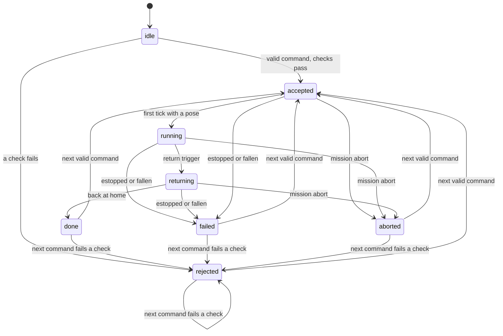
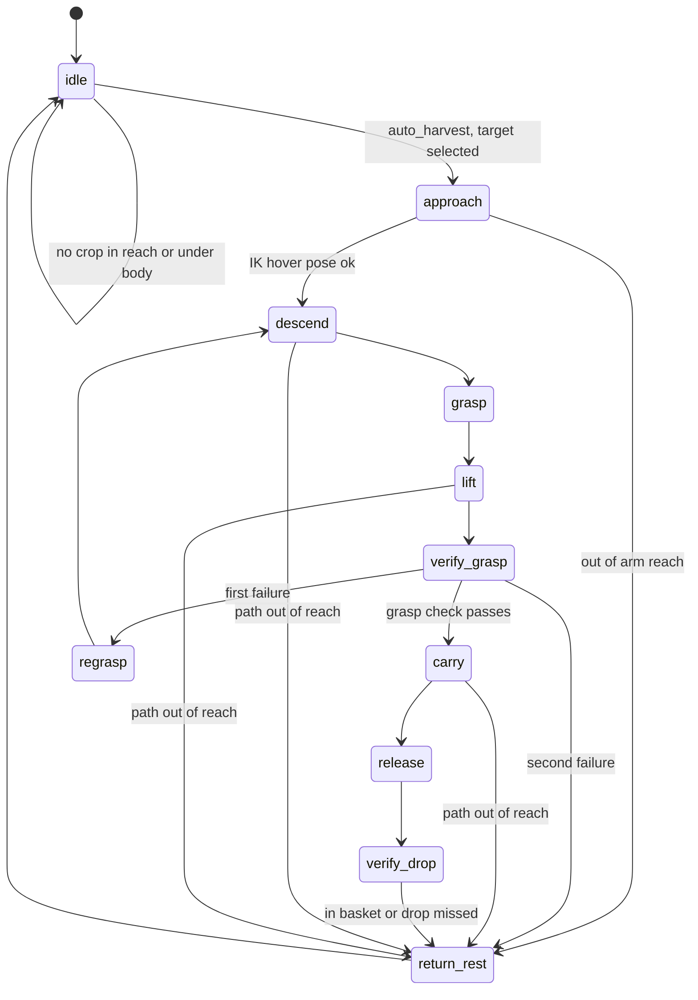
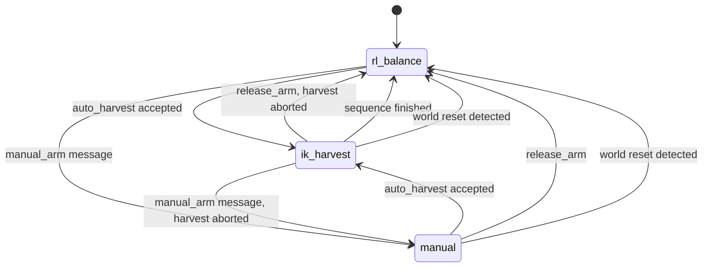
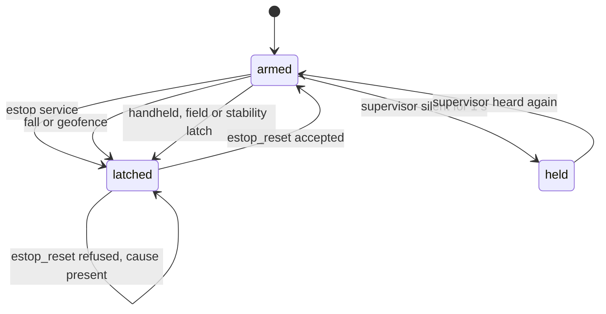
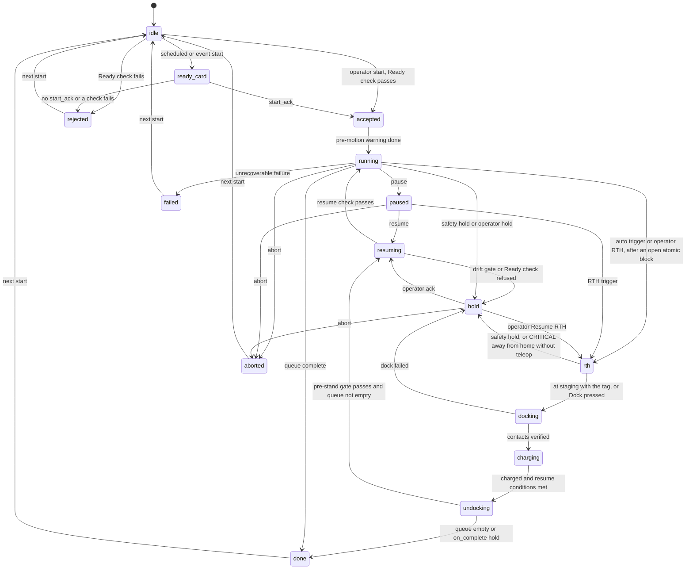
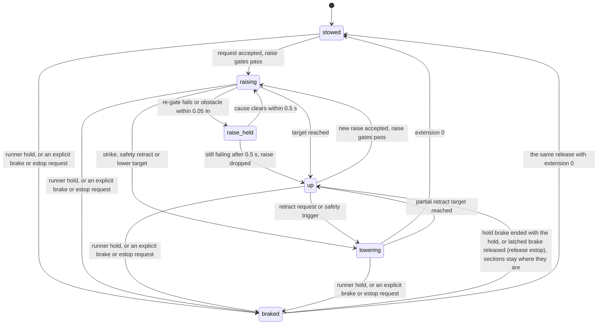
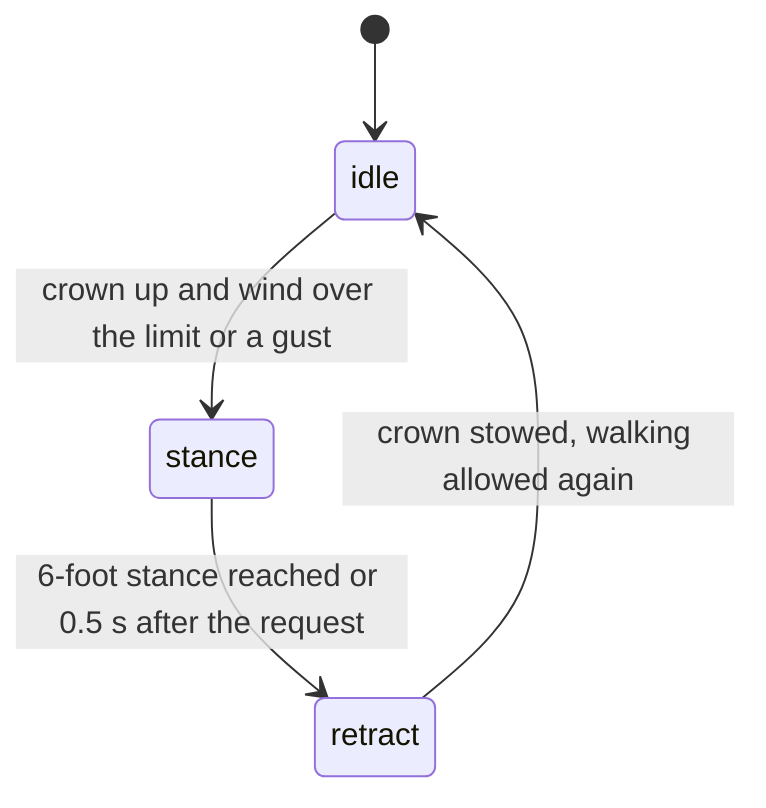
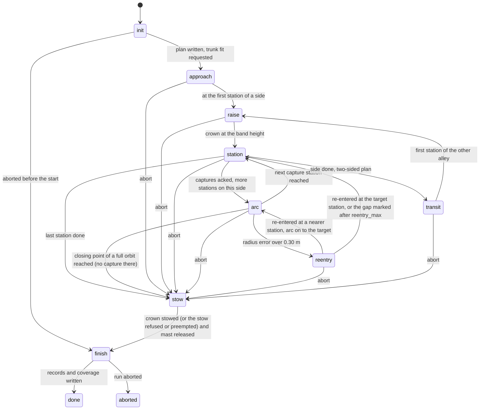
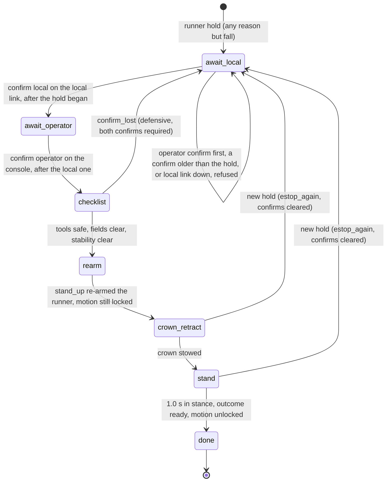
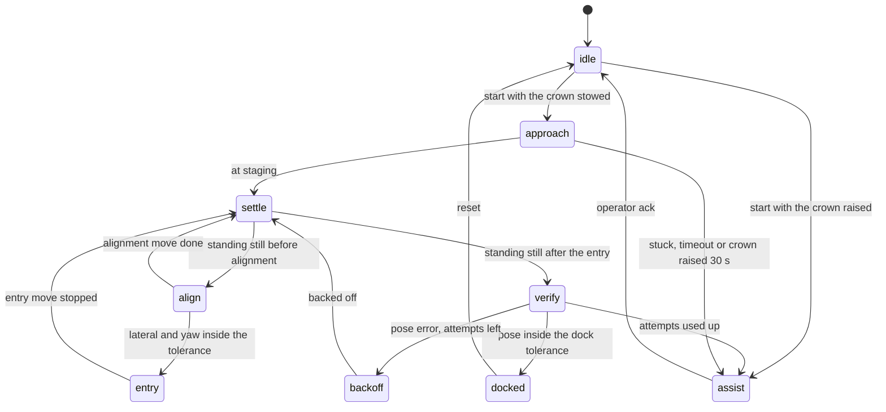

# State machines

Status: draft. Each machine has a Mermaid `stateDiagram-v2`, a states table and a transitions table that agree. Sections 2 to 5 and 7 to 11 describe code on `feat/nandi-pilot` @ 1840118 [BUILT] (sections 2 and 5 were first read from the mission and safety worktrees on 2026-11-17; both packages have merged since, and WP12 re-checked them against the merged code). Section 6 is the run-supervisor lifecycle of the phase C+ package WP38, [PROPOSED]: it extends section 2 for the orchard (RTH-DOCKING E.1, folded by WP12). Code wins where a table and the code disagree.

## 1 How the machines nest

| Level | Owner | Machine |
|---|---|---|
| Safety (outermost, always wins) | safety_supervisor [BUILT] with the WP6 field and stability latches and the WP1 handheld e-stop; hardware e-stop later (hardware e-stop requirement) | E-stop latch, section 5; e-stop recovery, section 9 |
| Run (orchard, phase C+) | run supervisor (WP38) [PROPOSED] | Run-supervisor lifecycle, section 6 |
| Recovery | `RecoveryManager` (WP28 hook `recovery`) [BUILT] | Recovery behaviours, section 9 |
| Crown | WP24 arbiter (hook `mast`) and WP6 crown supervisor (hook `stability`) [BUILT] | Mast and wind response, section 7 |
| Preset | TREE 360 recorder (WP25 hook `tree360`), DOCK/UNLOAD (WP13), WORK assist (WP29), the WP9 tour [BUILT] | sections 8, 10, 11 |
| Mission (legacy zone harvest) | mission_executor [BUILT] | Mission lifecycle, section 2 |
| Arm ownership | harvest_ik_service [BUILT] | Arm arbitration, section 4 |
| One pick | `HarvestSequence` in `atharv_nandi/core/harvest_logic.py` [BUILT] | Harvest phases, section 3 |

A latched e-stop freezes the actuators (sim_runner's safe hold), makes locomotion refuse `cmd_vel`, and ends an active mission as `failed` with reason `estopped`. A mission never clears an e-stop.

## 2 Mission lifecycle [BUILT]

Reading guide: `accepted`, `running` and `returning` are the active states; `done`, `rejected`, `failed` and `aborted` are terminal and carry a `reason_code`. A terminal state stays published until the next command, which is checked again from scratch. A command that arrives while a mission is active is refused with `busy` and does not change the running mission's state. A failed pick of one crop does not fail the mission: the executor retries once (2 attempts per crop) and then skips the crop.

### 2.1 States

| State | Meaning | Terminal |
|---|---|---|
| idle | No mission since start-up. Operator driving allowed | no |
| accepted | Command checked and planned, not moving yet | no (active) |
| running | Walking to targets and harvesting | no (active) |
| returning | Walking back to the home pose | no (active) |
| done | Returned home; `picked` counts only basket-truth picks | yes |
| rejected | Never started | yes |
| failed | Ended by a safety condition | yes |
| aborted | Ended by the operator | yes |

### 2.2 Transitions and reason codes

| From | To | Trigger | `reason_code` (mission package `REASONS`) |
|---|---|---|---|
| idle, done, rejected, failed, aborted | accepted | `/nandi/mission/command` parses and every check passes | empty |
| idle, done, rejected, failed, aborted | rejected | a check fails, in this order | `command_invalid`, `zone_invalid`, `expired` (`not_after` passed), `zone_outside_geofence`, `estopped`, `busy` (no robot state yet), `basket_full`, `battery_low` (route energy estimate plus reserve above the state of charge) |
| accepted, running, returning | (unchanged) | a new command | refused with `busy`, logged as an event |
| accepted | running | first step with a pose | empty |
| running | returning | return trigger, checked between picks | `completed`, `no_targets`, `max_picks`, `basket_full`, `battery_low`, `expired` |
| returning | done | last return waypoint reached | the return reason, carried |
| accepted, running, returning | failed | `safety_status.estopped` or fallen, checked every tick before anything else | `estopped`, `fallen` |
| accepted, running, returning | aborted | `/nandi/mission/abort` | `aborted` |

Per-pick outcomes are counted, not mission-terminal: the harvest node's `last_result` text is recorded, but `picked` moves only when `/nandi/game_status.in_basket` rises (mission package counting rule).

Gap against the platform mission lifecycle: the legacy zone mission still has no `rtk` rejection. The RTK-fix rule requires a rover mission to be rejected with reason `rtk` without a fixed RTK solution. The orchard presets have it: the WP27 Ready check refuses `rtk` unless the WP7 fix is FIXED (or FLOAT for presets marked `float_ok`), on the modelled GNSS ([sim-fidelity-register.md](sim-fidelity-register.md)). The legacy mission needs the same check before the HAL ([hal-sim-to-real.md](hal-sim-to-real.md)).

### 2.3 Mapping to the platform mission lifecycle

| Nandi state | Platform lifecycle state | `cmd/mission/ack` (broker contract section 6: one final ack of `done`, `rejected` or `failed`) |
|---|---|---|
| idle | (before Planned) | none |
| accepted | Planned -> Ready (checks pass) | `accepted` (interim) |
| rejected | Ready -> Rejected | `rejected` + reason |
| running, returning | Running | none |
| done | Running -> Closed (done) | `done` |
| failed | Running -> Closed (safety failure) | `failed` + reason |
| aborted | Running -> Closed (`cmd/abort`) | `failed` + `reason: aborted` (the broker contract has no `aborted` ack; the reason carries it) |

Nandi has no `Paused`, `Anchored`, `Verified`, `Analysed`, `Reviewed`, `Quarantined` or `InAtharv` states: those belong to the platform's evidence chain, and a simulated mission is never anchored (evidence rule). The command name is an open question: this design follows the recommended option A, one command `cmd/mission` with `plan.source = zone_alert`. If `inspect_zone` is chosen instead, only the bridge mapping changes. The bridge itself is not built ([hld.md](hld.md) section 4).

## 3 Harvest phases [BUILT]

The phases are the `phase` strings `HarvestSequence` publishes through `/nandi/harvest_status` (code: `atharv_nandi/core/harvest_logic.py` on `feat/nandi-pilot`).

Reading guide: one `auto_harvest` call runs one pick. Every path ends in `return_rest`, so the arm always goes home (code: `HarvestSequence.run`). An abort (release, manual override, world reset) can end any phase and is shown in section 4, not here.

| From | To | Trigger | `last_result` text (code) |
|---|---|---|---|
| idle | approach | `/nandi/auto_harvest`, `select_target` found a crop within 1.08 m (code: `REACH_M`) | none yet |
| idle | idle | nothing in reach, or nearest crop under the body | `No crop in reach (...)`, `... under the body - back up` |
| approach | descend | IK finds the hover pose 0.125 m above the crop centre (code: `GRASP_TIP_DZ` 0.025 + `APPROACH_DZ` 0.10) | none |
| approach | return_rest | IK fails | `crop_item_k out of arm reach (X.XX m), move closer` |
| descend, lift, carry | return_rest | a Cartesian waypoint IK misses by more than the solver tolerance, 3 mm (code: `arm_ik_solver.py`, `pos_tol=0.003`) | `Arm path out of reach (N cm off)` |
| descend | grasp | at grasp pose, sag settled | none |
| grasp | lift | fingers closed, 0.3 s wait | none |
| lift | verify_grasp | lifted 0.20 m (code: `LIFT_DZ`) | none |
| verify_grasp | carry | crop rose >= 0.05 m and is <= 0.06 m from the tip (code: `GRASP_MIN_RISE_M`, `GRASP_MAX_TIP_DIST_M`) | none |
| verify_grasp | regrasp | first failure: open, wait 0.6 s | none |
| verify_grasp | return_rest | second failure | `Grasp failed on crop_item_k (2 attempts)` |
| carry | release | over the left basket channel | none |
| release | verify_drop | fingers open | none |
| verify_drop | return_rest | basket truth within 1.5 s (15 x 0.1 s, code) | `Harvested crop_item_k into basket` or `Drop missed: crop_item_k not in basket` |
| return_rest | idle | arm at rest | (kept) |

### 3.1 Lesson: the grasp-check false positive

Observed on a live sim on 2026-11-17 (reported by the operator, not a recorded run): after `reset_world`, `auto_harvest` went approach, descend, grasp, lift, carry, release, verify_drop, return_rest and ended `Drop missed: crop_item_1 not in basket`, with `crop_item_1` still on the ground at x 0.594 m (it started at 0.62 m). The gripper never carried it, yet `verify_grasp` passed.

What the code shows: the check on `feat/nandi-pilot` is one sample of the crop position after the lift, two conditions (rose >= 5 cm, within 6 cm of the tip), and nothing checks the crop again during `carry`. A crop that is sliding out of the pads can satisfy both conditions at the instant of the sample and be on the ground before `release`. The harvest work package reports exactly this ("the old check (rise + 6 cm from the tip, one sample) passed a crop that was creeping out of the grip at ~8 cm/s") and is changing the check to a tighter tip distance (4.5 cm), a slip test over 0.3 s (at most 0.6 cm drift relative to the tip) and a hold check during carry (`feat/nandi-harvest` commit `52d919a`, constants `GRASP_MAX_TIP_DIST_M` 0.045, `GRASP_MAX_SLIP_M` 0.006, `PATH_TOL` 0.015, read 2026-11-17; not merged into `feat/nandi-pilot`, [PENDING-MERGE]). The 8 cm/s figure is that package's statement, [UNVERIFIED] here.

The earlier `Arm path out of reach (0.9 cm off)` is the 3 mm per-waypoint tolerance aborting a crop the up-front check had accepted; the same package moves to a strict up-front column plan plus a 1.5 cm path tolerance [PENDING-MERGE].

Design rules taken from it (apply to every future check, sim or real):

1. **A success check reads the outcome, not the actuator.** Basket truth decides a pick (pilot criterion P-01); a gripper "closed" flag never does.
2. **A hold is a condition over time, not a sample.** Check it at least twice with a gap, and keep checking while carrying.
3. **Every check reports its numbers** (`rose 0.2 cm, 6.1 cm from the tip`) so a false positive is visible in the log, and every attempt whose grasp check passed but whose crop did not reach the basket counts as a false positive (pilot criterion P-03), whether the crop never rose or rose and slipped out, as in this case.
4. **On real hardware the sim's ground-truth crop pose does not exist.** The hold check must move to a measurable signal: finger position error at a commanded closed width, finger motor current, or a wrist camera ([hal-sim-to-real.md](hal-sim-to-real.md) section 3).

## 4 Arm arbitration [BUILT]

Modes are the `mode` field of `/nandi/harvest_status` (code: `atharv_nandi/nodes/harvest_ik_service.py`).

Reading guide: `rl_balance` is home. The operator (a manual slider) always wins over a running harvest. A harvest is refused while one is running or while an aborted one is still stopping.

| From | To | Trigger | Notes |
|---|---|---|---|
| rl_balance, manual | ik_harvest | `/nandi/auto_harvest` with a selected target | refused with `Harvest already running` in `ik_harvest`, `Previous harvest still stopping - try again` while the old worker lives, `No sim state yet` before the first `sim_qpos` |
| rl_balance | manual | a 7-value `/nandi/manual_arm` message | |
| ik_harvest | manual | a `/nandi/manual_arm` message | `Manual override: harvest of ... aborted` |
| manual | rl_balance | `/nandi/release_arm` | `Manual arm released to RL balance` |
| ik_harvest | rl_balance | `/nandi/release_arm` | `Released: harvest of ... aborted` |
| ik_harvest | rl_balance | sequence returned | arm goal = rest |
| ik_harvest, manual | rl_balance | `world_reset_detected` on `sim_qpos` (trunk jump > 0.10 m or arm or crop jumps, code: `RESET_*`) | `World reset: harvest of ... aborted` |

Interaction with the e-stop (safety package, [BUILT]): while the latch is set, `sim_runner` ignores `/nandi/arm_targets` and `/nandi/leg_targets` and holds every actuator at its angle at the moment of engage. The harvest node itself is not changed by the safety package, so a running harvest keeps stepping its sequence (and its command keeps moving) during the hold. Read from the code, not tested: on `estop_reset` the actuators would then be driven from the held pose toward wherever the sequence got to [UNVERIFIED]. Proposal for the integrator: on the rising edge of `estopped`, harvest_ik_service aborts any `ik_harvest` (as `release_arm` does) and snaps its command to the measured arm pose, so reset never causes a jump.

## 5 E-stop latch [BUILT]

Reading guide: the latch keeps the first reason until a successful reset. An `operator` latch clears on request; a `fall` or `geofence` latch refuses `estop_reset` while its cause is still present. `held` is not a latch: it is sim_runner's own fail-safe when it has seen the supervisor and then stops hearing `safety_status`. All of this is the software layer. hardware e-stop requirement needs a hardware e-stop that cuts motor power, and per no-software-override rule no software (vision, mission, this supervisor) can override that hardware stop.

| From | To | Trigger (safety package code and `config/safety.yaml`) | Effect |
|---|---|---|---|
| armed | latched | `/nandi/estop` (the console's STOP calls it) | reason `operator`; sim_runner safe hold (actuators keep their `kp`, velocity gain `kv` x 3.0); locomotion stops the gait and refuses `cmd_vel`; an active mission ends `failed` / `estopped` |
| armed | latched | trunk tilt above 35 deg sustained 0.3 s, or `game_status` fallen | reason `fall`, same effect |
| armed | latched | trunk outside the keep-in polygon (default a rectangle from x -1.5 to 7.0 m and y -2.0 to 2.0 m around the plot) | reason `geofence`, same effect |
| armed | latched | the paired handheld reports its mushroom pressed (WP1 `/nandi/handheld_estop/state` `estop_request`); or the WP6 hook latches a field or stability stop on `/nandi/safety_fields` | reasons `handheld`, `protective`, `animal`, `bumper`, `stability`; reset refused while the handheld is pressed, while `protective_clear` is false, or while the payload is older than 1 s |
| armed | held | sim_runner saw the supervisor and then no `safety_status` for 1.0 s (`SUPERVISOR_TIMEOUT_S`) | safe hold with reason `supervisor_lost` |
| held | armed | `safety_status` arrives again and is not estopped | hold released |
| latched | latched | `cmd_vel` while estopped | refused by locomotion |
| latched | armed | `/nandi/estop_reset` and the cause is clear (operator: always; fall: robot upright; geofence: trunk at least 0.1 m back inside) | replies `E-stop reset (was '<reason>')`; gait stays stopped until a new command |
| latched | latched | `/nandi/estop_reset` while the cause is present | replies `Refused: cause '<reason>' still present` |

Related watchdogs that do not latch: locomotion stops the gait and holds the last leg pose when `/nandi/sim_qpos` is older than 0.5 s; the supervisor reports a node as not ok when its `/nandi/heartbeat` is older than 2.0 s; the speed cap limits `gait_params[0]` to 1.0 and `|cmd_vel|` to 1.0. Stop metrics (time and trunk travel from engage until trunk speed is below 0.02 m/s) are published in `safety_status.last_stop` and are what pilot criteria P-07 and P-08 read.

Gaps against the safety case: comms loss is a hold, not a latch: the WP7 local-link watchdog (0.5 s) and cloud-link watchdog (5 s) drive the WP28 LOCAL LINK and CLOUD LINK behaviours (section 9), which need an operator ack to resume. There is still no latch on speed-cap breach (the cap clamps instead). See [safety-case.md](safety-case.md) HZ-05 and HZ-06.

## 6 Run-supervisor lifecycle (orchard extension of section 2) [PROPOSED]

Source: RTH-DOCKING E.1 and E.2 (package WP38 `atharv_nandi/core/run_supervisor.py`, phase C+, not built). The supervisor is the only consumer of operator commands, latches RTH reasons, owns checkpoints and dispatches presets to the workflow engine (section 11) or the legacy path. It extends section 2 with the states the orchard needs: a ready card for scheduled starts, `paused`, return-to-home and the dock cycle. The diagram below is WP12's reading of E.1 and E.2; WP38 owns the final transition list and code will win.

| State | Meaning | Terminal |
|---|---|---|
| idle | no run; operator driving allowed | no |
| ready_card | a scheduled or event start waits for `start_ack` on the console | no |
| accepted | Ready check passed; pre-motion warning (3 s, beacon `premotion`) | no (active) |
| running | the engine or a legacy preset runs targets | no (active) |
| paused | the operator paused; posture recorded for the resume | no (active) |
| rth | AUTO_RTH, MANUAL_RTH or TELEOP_HOME: crown stowed, walking home | no (active) |
| docking | staged alignment and entry (section 10 is today's WP13 dock) | no (active) |
| charging | on the dock, charging | no (active) |
| undocking | backing off the dock; E.6 pre-stand gate | no (active) |
| resuming | return to the checkpoint, drift gate, posture restore | no (active) |
| hold | standing hold or safe park, waiting for the operator | no (active) |
| done, rejected, failed, aborted | terminal, with a reason code; next start is checked from scratch | yes |

| From | To | Trigger | Rule |
|---|---|---|---|
| running | rth | battery, wind, rain, storm, heat, visibility, cloud loss (after a local supervisor ack), done, operator | only after an open `atomic` contact block completes or rolls back (WORKFLOWS-SPEC A.2) |
| rth | hold | e-stop, local-link loss, fall, protective stop; battery CRITICAL away from home without teleop | L0 priority (E.2 item 1) |
| hold | rth | operator "Resume RTH" | followed by the pre-motion warning; TELEOP release always lands in `hold`, never in `docking` |
| charging | undocking | SoC and weather resume conditions | every arrow after `charging` passes the E.6 pre-stand gate |
| any active | hold | operator hold | |

Cancel and defer rights bind to the highest latched RTH reason, never to the mode or owner: `rth_done`, `rth_operator` may be cancelled back into the mission; `rth_battery` may be deferred once for 5 min while SoC > WARN; wind, rain, heat, storm, visibility and battery CRITICAL allow only TELEOP_HOME or HOLD; `rth_cloud_loss` exists only after a local supervisor ack (OQ-39 A). Until WP38 lands, today's orchard stack has no run supervisor: presets are queued by the console (`PresetQueue`, WP27 / WP10), RETURN HOME and SAFE PARK are WP28 behaviours (section 9), and the dock is WP13 (section 10).

## 7 Crown mast and wind response [BUILT]

Source: `atharv_nandi/core/mast.py`, `atharv_nandi/sim/hooks/mast.py` (WP24) and `CrownSupervisor` in `atharv_nandi/sim/hooks/stability.py` (WP6). The mast has one writer, the arbiter; requests come from the sources e-stop > safety > recovery > preset (the WP24 package notes).

| State | Meaning (`/nandi/mast/state`) |
|---|---|
| stowed | `ext_m` 0 |
| raising | moving up at 0.2 m/s; gates re-checked every 50 Hz tick |
| raise_held | `held_by` `gate:<detail>` or `near_obstacle`; at most one tick (4 mm) of travel after the cause |
| up | above 0, not moving (any extension up to 1.60 m) |
| lowering | moving down; a `safety` retract always runs, a downward move that would close on an obstacle stops (`lower_blocked`) |
| braked | `braked` true: every request dropped and new ones refused. A brake from the runner hold (the hook's hold brake, also a `brake()` or `estop` request that arrives while the runner holds) ends with the hold; an explicit `brake()` or `estop` request outside a hold sets `brake_latched` and stays on through the end of any hold until `release("estop")` (`release_brake()`) |

| From | To | Trigger | Notes |
|---|---|---|---|
| stowed, up | raising | a `preset` or `recovery` request above the extension | raise gates: e-stop, standing (≤ 0.05 m/s), cross ≤ 3°, wind < 10 m/s and no gust, WP6 gates (6-foot ≥ 0.13 m at the target), swept clearance ≥ 0.10 m; refused requests leave the state unchanged with `reason` `crown_gate`, `crown_clearance`, `wind`, `slope` or `stability` |
| raising, up | lowering | strike (distance ≤ 0), wind ≥ 10 m/s or a gust, tilt > 12°, filtered tilt > 6°, margin, local-link loss, low battery, operator stow | a strike submits the safety retract in the same physics substep |
| stowed, raising, up, lowering | braked | `sim_runner` safe hold (any e-stop latch), or an explicit `brake()` / `estop` request (`brake_latched` when it arrives outside a hold) | after the hold nothing re-raises by itself: WP28 e-stop recovery sends the retract |
| braked | up, stowed | the hold ends and `brake_latched` is false; or `release("estop")` for a latched brake | the end of the hold never releases a latched brake (`atharv_nandi/core/mast.py`, `atharv_nandi/sim/hooks/mast.py`) |

Wind response (WP6 `wind_state`), ordered so the robot never walks or retracts on three feet in a gust:

| State | Meaning |
|---|---|
| idle | no wind action; crown-up walking allowed below 8 m/s |
| stance | gait stopped into a 6-foot stance (`stance_request`); walking inhibited |
| retract | WP24 `safety` retract to 0; walking inhibited until stowed |

| From | To | Trigger |
|---|---|---|
| idle | stance | walking crown-up: wind ≥ 8 m/s or a gust; standing: ≥ 10 m/s or a gust |
| stance | retract | 6-foot stance standing, or 0.5 s after the stance request |
| retract | idle | extension 0 |

MEASURED (WP6, 11 m/s gust, ext 1.6): stance 0.12-0.28 s after the request, retract 0.22-0.36 s after it, no fall. The tour segment C2 measured 0.54 s from the gust's truth onset to the stance (gate 0.5 s, open; [safety-case.md](safety-case.md) HZ-11).

## 8 TREE 360 phases [BUILT]

Source: `PHASES` in `atharv_nandi/core/tree360.py` (WP25), published as `phase` on `/nandi/tree360/progress`.

| State | Meaning |
|---|---|
| init | orbit plan, band plan and recorder created |
| approach | walking to the first station (crown stowed) |
| raise | standing raise to the band height through the WP24 arbiter |
| station | standing captures (low, mid, high bands); waits for each perception ack |
| arc | closed-loop side orbit; radius error > 0.15 m slows to 0.1 m/s |
| reentry | stopped on a radius error > 0.30 m; walks back to the nearest station (at most `reentry_max`, then the gap is marked) |
| transit | two-sided mode: crown stowed, walking around the row |
| stow | crown to 0, mast released |
| finish | coverage, Merkle manifest, TreeRecord and the deep-scan request |
| done | terminal: coverage evaluated (`coverage_pass`), records published |
| aborted | terminal: no deep-scan request and no record file for an aborted visit |

| From | To | Trigger |
|---|---|---|
| arc | reentry | `abs(R_meas − R_cmd)` > 0.30 m |
| reentry | arc | re-entered at the nearest station, which is not the target: the arc continues to the target |
| reentry | station | the nearest station is the target, or after `reentry_max` re-entries a `gap_marked:<k>` note and a walk to the target station |
| station | transit | the last station of side A in a two-sided plan (orbit blocked or hedgerow spacing) |
| approach, raise, station, arc, reentry, transit | stow | abort (operator, e-stop, field latch, timeout); every abort in a phase other than `init` and `finish` stows first (`_abort`) |
| finish | done, aborted | the run status |

A station with `capture` false (the closing point of a full orbit, `orbit.Station.capture`) is reached inside `arc` without a `station` phase, so a full orbit ends `arc` -> `stow`; `raise` -> `arc` and `arc` -> `transit` follow the same rule. `tests/test_wp12_docs.py` checks that the state table and the diagram name exactly the code's `PHASES` and that every moving phase has its abort edge to `stow`.

## 9 Recovery behaviours and e-stop recovery [BUILT]

Source: `RecoveryManager` in `atharv_nandi/core/recovery_behaviours.py` and the hook `atharv_nandi/sim/hooks/recovery.py` (WP28, the WP28 package notes). One behaviour runs at a time, by priority FALLEN > E-STOP RECOVERY > LOCAL LINK > CLOUD LINK > RETURN HOME > STUCK > SAFE PARK. An assist or an operator Halt waiting for the operator is only taken over by the four safety behaviours. Every behaviour ends with the crown stowed; WP28 never re-raises.

| Behaviour | Trigger | Ends in |
|---|---|---|
| FALLEN | tilt > 35° for 0.3 s, or hold reason `fall` | `manual` after the checklist (crown lock, lift points, two people, laterals, `person_clear` last); never stands up by itself |
| E-STOP RECOVERY | the runner hold, any reason but `fall` | `ready` (diagram below) |
| LOCAL LINK | `link.local` lost (> 0.5 s) | hold, locked, until "Resume / Halt" |
| CLOUD LINK | `link.cloud` lost (> 5 s) with the local link up | safe park at the alley edge, hold; queue paused, 0 new targets |
| RETURN HOME | `energy_action == return_and_wait`, or operator | `home` (estimate ≤ 0.2 m) or `assist` |
| STUCK | progress < 2 cm in 5 s along the command, or feet sunk > 5 cm for 1 s | `recovered` after 0.7 m, or `assist` after two rungs |
| SAFE PARK | operator, or cloud loss | hold after ≤ 3 m to the nearest alley edge or headland |

E-stop recovery (MISSION-PRESETS 8; the interlock mutation test runs 172 event sequences). The state names are the `step` values of `EstopRecovery` (`/nandi/recovery/state`):

| Step | Meaning |
|---|---|
| await_local | runner hold; nothing moves; only a local confirmation is accepted (the status shows the last six refusals) |
| await_operator | `confirm local` arrived on `/nandi/recovery/local` with the local link up, after the hold began |
| checklist | `confirm operator` arrived on `/nandi/recovery/cmd` after the local one; waits until tools safe, WP6 protective field clear and the WP6 stability latch clear |
| rearm | checklist passed; asks `stand_up` while the runner still holds; the gait stays locked |
| crown_retract | the runner left the hold; WP24 `recovery` retract to 0 (WP24 refuses every request during the hold, so the retract follows the re-arm: a deviation from the MP 8 order "crown brake, retract, stand up") |
| stand | crown stowed; the gait holds a stance for 1.0 s |
| done | outcome `ready`: unlocked; `resume_from` = the last completed tree, the item active at the e-stop is `aborted_item` (never resumed mid-cut) |

A new hold during `crown_retract` or `stand` restarts at `await_local` with the confirmations cleared. In `rearm` the hold is still the one being released, so there is no restart edge from it. `tests/test_wp12_docs.py` checks the step names and the restart steps against `EstopRecovery`.

## 10 Dock alignment and DOCK/UNLOAD session [BUILT]

Source: `STATES` and `SESSION_STEPS` in `atharv_nandi/core/dock_logic.py` (WP13; WP37 replaces it at the C+ boundary). The aligner:

| State | Meaning |
|---|---|
| idle | not docking |
| approach | walking to staging (timeout 90 s) |
| settle | standing still (trunk < 0.01 m/s and yaw rate < 0.03 rad/s for 0.4 s) before the next decision |
| align | fine alignment at staging: lateral 12 mm, yaw 2° (timeout 40 s, at most 12 rounds) |
| entry | creep into the dock; aborts if lateral > 45 mm or yaw > 6° (timeout 40 s) |
| verify | pose check against the dock tolerance |
| backoff | reverse out for another attempt (timeout 20 s) |
| docked | terminal for the aligner; the session continues with `charge` |
| assist | needs a person: `dock_failed`, `crown_gate`, `stuck` |

The DOCK/UNLOAD session steps run in this order: `park_crate`, `unload`, `jobsheets`, `dock`, `charge`, `sync`, `done`; any step can go to `assist` with its reason (for example `charge_contact_lost` after 2 s off the contacts, `charge_timeout`, or an unload refusal), and `/nandi/dock/cmd` `ack` returns it to the step.

| Step | Meaning |
|---|---|
| park_crate | walk to the crate |
| unload | WP3 tray unload into the crate |
| jobsheets | publish the job sheets (WP9 callback) |
| dock | the aligner above |
| charge | time-compressed charge (`time_compressed_charge`) |
| sync | hub sync stub |
| done | session finished |
| assist | waiting for a person, with the reason |

## 11 WORK assist and the workflow engine [BUILT]

WORK assist (WP29 `WorkAssist.state()` phase on `/nandi/work/state`): `idle` → `running` → `at_stop` (lead-to-marks) or `delivered` (tote) → `running` …, with `paused` (operator pause), `stopped` (latched `tag_lost` after more than 2 s without a tag reading: a resume needs the tag back and an operator `resume`), `done` and `aborted` (operator abort or halt). The WP6 protective latch acts on everyone, the tag holder included.

| Phase | Meaning |
|---|---|
| idle | no mode |
| running | following, leading or carrying |
| at_stop | lead-to-marks: at a MARK, waiting for the worker |
| delivered | tote delivered |
| paused | paused by the operator |
| stopped | latched `tag_lost`; waits for the tag and an operator resume |
| done | mode finished |
| aborted | aborted or halted by the operator |

Workflow engine (WP34 `atharv_nandi/core/workflow/engine.py`, py_trees 2.2.3, 10 Hz): active states `running`, `pausing`, `resuming`, `aborting`, `finalising`; request priority abort > rth > safe_park = halt > pause > skip. L0 rules run before every tick and are not YAML: e-stop not clear → stop now, terminal `estopped`, an open atomic logged `dropped`; protective field occupied or the local link lost after `start_ack` → freeze (active clock frozen). A resume runs `_lib/resume_check@1` (Ready check, return to `last_safe`, drift gate within 2 s) and needs an ack after a pause longer than 15 min. The engine is built and tested on stubs (fault matrix: 90 cases, no invariant violation); the run supervisor that attaches it to the live stack is WP38 (section 6).
